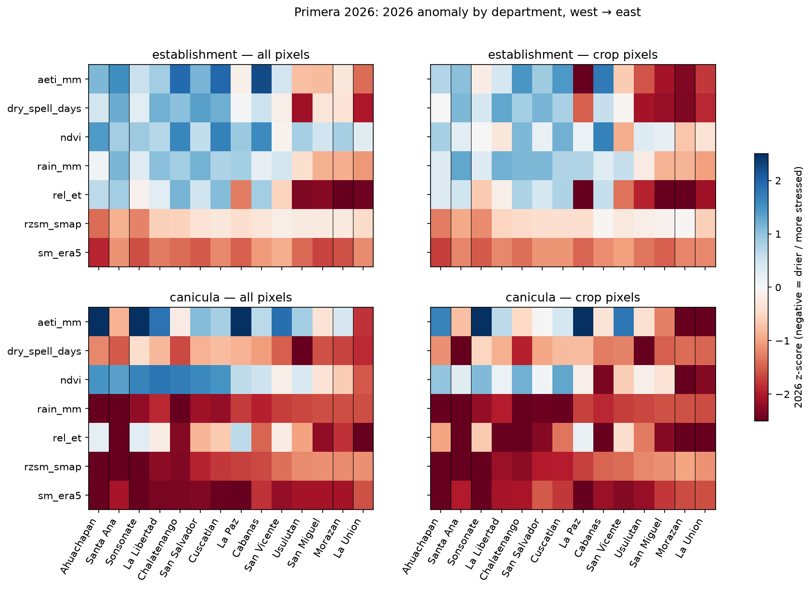

# Primera 2026 — do the inputs see the field-reported damage?

Field: irreversible damage in La Union and Morazan; Santa Ana much less affected.
A metric agrees when both eastern departments rank in the 5 most stressed of 14 and their mean z is below Santa Ana's. Rank 1 = most stressed. `east_minus_west_z` < 0 means the east looks worse, as the field reported.

## establishment (4/20–6/15)

| metric         | mask   |   rank_La Union |   rank_Morazan |   rank_Santa Ana |   east_minus_west_z | agrees   |
|:---------------|:-------|----------------:|---------------:|-----------------:|--------------------:|:---------|
| rel_et         | all    |               2 |              1 |               12 |               -3.42 | True     |
| dry_spell_days | crop   |               4 |              1 |               12 |               -3.22 | True     |
| rel_et         | crop   |               4 |              1 |               11 |               -3.17 | True     |
| aeti_mm        | crop   |               4 |              2 |               11 |               -3.09 | True     |
| dry_spell_days | all    |               2 |              3 |               13 |               -2.41 | True     |
| aeti_mm        | all    |               1 |              4 |               11 |               -2.36 | True     |
| rain_mm        | crop   |               1 |              3 |               14 |               -2.24 | True     |
| rain_mm        | all    |               1 |              2 |               13 |               -2.15 | True     |
| ndvi           | crop   |               3 |              2 |                9 |               -0.78 | True     |
| ndvi           | all    |               2 |              7 |                8 |               -0.29 | False    |
| sm_era5        | all    |              11 |              4 |               12 |               -0.27 | False    |
| sm_era5        | crop   |              10 |              7 |                8 |                0    | False    |
| rzsm_smap      | all    |               6 |             11 |                3 |                0.53 | False    |
| rzsm_smap      | crop   |               4 |             14 |                3 |                0.64 | False    |

## canicula (7/1–8/20)

| metric         | mask   |   rank_La Union |   rank_Morazan |   rank_Santa Ana |   east_minus_west_z | agrees   |
|:---------------|:-------|----------------:|---------------:|-----------------:|--------------------:|:---------|
| ndvi           | crop   |               3 |              1 |               10 |               -2.98 | True     |
| aeti_mm        | crop   |               2 |              1 |                4 |               -2.73 | True     |
| ndvi           | all    |               1 |              2 |                8 |               -2.44 | True     |
| dry_spell_days | all    |               2 |              3 |                6 |               -0.24 | True     |
| rel_et         | crop   |               6 |              1 |                3 |               -0.06 | False    |
| aeti_mm        | all    |               1 |              5 |                2 |                0.17 | False    |
| sm_era5        | all    |              14 |             11 |               12 |                0.22 | False    |
| sm_era5        | crop   |              13 |             12 |                9 |                0.36 | False    |
| rain_mm        | crop   |              12 |             14 |                2 |                1.23 | False    |
| rain_mm        | all    |              12 |             14 |                1 |                1.31 | False    |
| rel_et         | all    |               2 |              5 |                1 |                1.35 | False    |
| dry_spell_days | crop   |               5 |              6 |                1 |                1.36 | False    |
| rzsm_smap      | all    |              14 |             12 |                2 |                1.88 | False    |
| rzsm_smap      | crop   |              13 |             14 |                2 |                2.27 | False    |

## response (7/15–9/10)

| metric         | mask   |   rank_La Union |   rank_Morazan |   rank_Santa Ana |   east_minus_west_z | agrees   |
|:---------------|:-------|----------------:|---------------:|-----------------:|--------------------:|:---------|
| ndvi           | crop   |               2 |              1 |                9 |               -4.05 | True     |
| ndvi           | all    |               1 |              2 |                8 |               -3.34 | True     |
| aeti_mm        | crop   |               2 |              1 |                5 |               -3.21 | True     |
| aeti_mm        | all    |               1 |              5 |                3 |               -0.52 | True     |
| dry_spell_days | crop   |               8 |              6 |                9 |               -0.29 | False    |
| dry_spell_days | all    |               3 |              5 |                6 |               -0.16 | True     |
| rain_mm        | crop   |               8 |              2 |                5 |               -0.04 | False    |
| rain_mm        | all    |               7 |              2 |                3 |                0.08 | False    |
| sm_era5        | all    |              14 |             11 |               12 |                0.28 | False    |
| sm_era5        | crop   |              13 |             12 |               10 |                0.32 | False    |
| rel_et         | crop   |              10 |              1 |                2 |                1.42 | False    |
| rel_et         | all    |               3 |              5 |                1 |                2.11 | False    |
| rzsm_smap      | all    |              13 |             12 |                2 |                2.22 | False    |
| rzsm_smap      | crop   |              13 |             14 |                2 |                2.58 | False    |

## season (4/20–8/31)

| metric         | mask   |   rank_La Union |   rank_Morazan |   rank_Santa Ana |   east_minus_west_z | agrees   |
|:---------------|:-------|----------------:|---------------:|-----------------:|--------------------:|:---------|
| aeti_mm        | crop   |               2 |              1 |                7 |               -4.13 | True     |
| rel_et         | crop   |               3 |              1 |                9 |               -3.77 | True     |
| ndvi           | crop   |               2 |              1 |               10 |               -2.82 | True     |
| rel_et         | all    |               2 |              3 |                5 |               -2.13 | True     |
| dry_spell_days | crop   |               4 |              1 |                6 |               -1.96 | True     |
| dry_spell_days | all    |               2 |              3 |               10 |               -1.96 | True     |
| ndvi           | all    |               1 |              4 |                8 |               -1.86 | True     |
| aeti_mm        | all    |               1 |              4 |                5 |               -1.47 | True     |
| rain_mm        | crop   |               5 |              1 |               12 |               -0.55 | True     |
| rain_mm        | all    |               3 |              1 |               10 |               -0.46 | True     |
| sm_era5        | all    |              14 |             11 |               12 |                0.19 | False    |
| sm_era5        | crop   |              13 |             12 |               10 |                0.37 | False    |
| rzsm_smap      | all    |              12 |             11 |                2 |                1.98 | False    |
| rzsm_smap      | crop   |              11 |             14 |                2 |                2.37 | False    |
